# 科研智能体与Skill入门
* DataWhale & 他山科学智能社区
* https://community.tashan.ac.cn/learning
* https://github.com/TashanGKD/panshi-ai4s-practice
## 从零开始搭建智能体
### Agent= Model+Harness
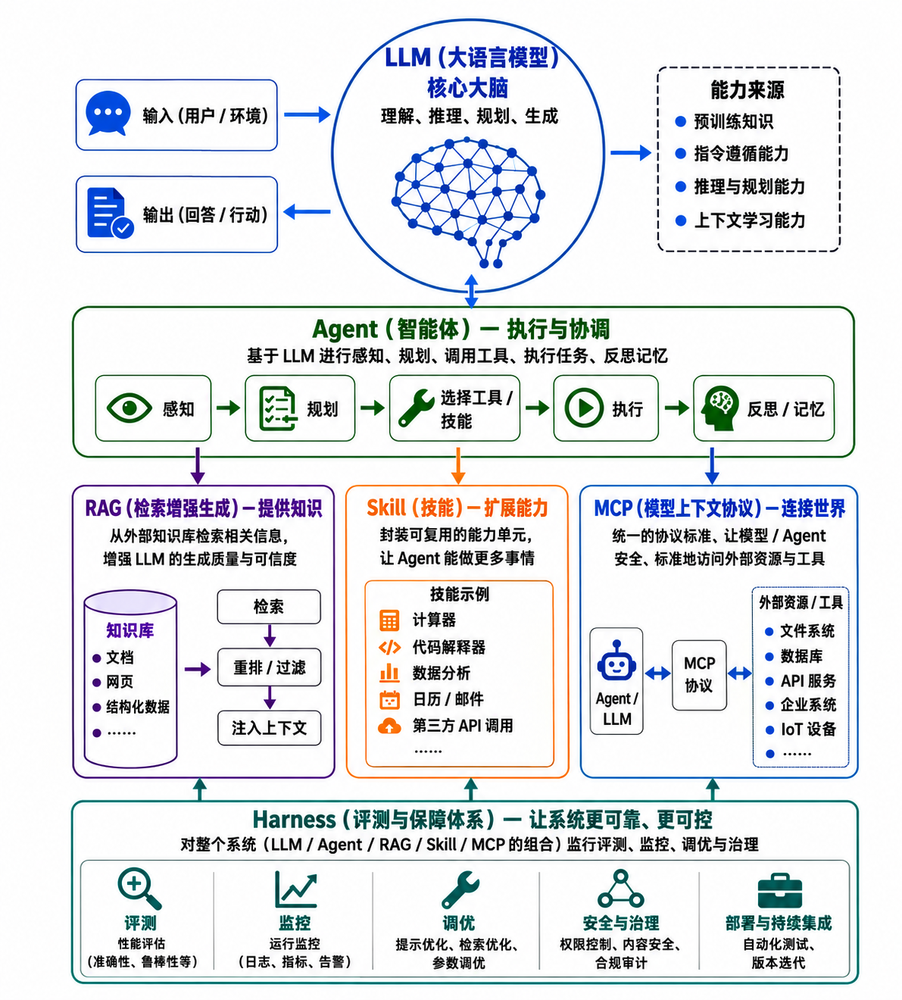
### LLM特性
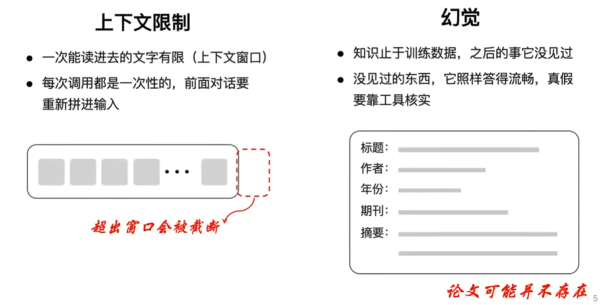
### agent运行模式
#### agent运行模式的扩展
* 理想
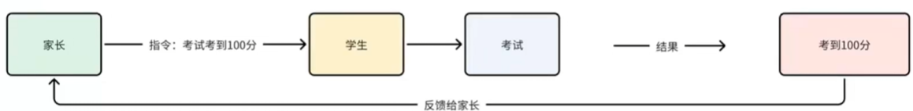
* 实际1  
  由于LLM能力特性达不到
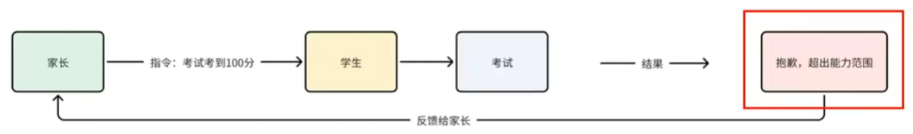
* 优化1  
把目的拆分为多个步骤去简化
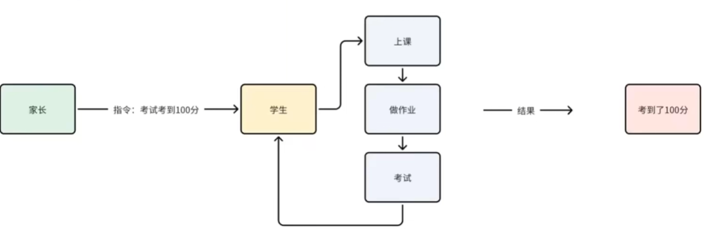
* 优化2   
增加多个agent去提升能力，去相互监督？相互提升？
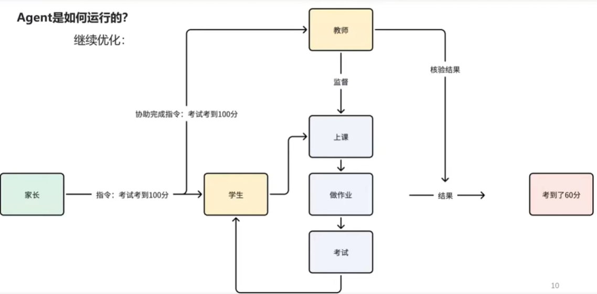
* 优化3  
增加skill, 提供学习的路径和方法，或者说demo  
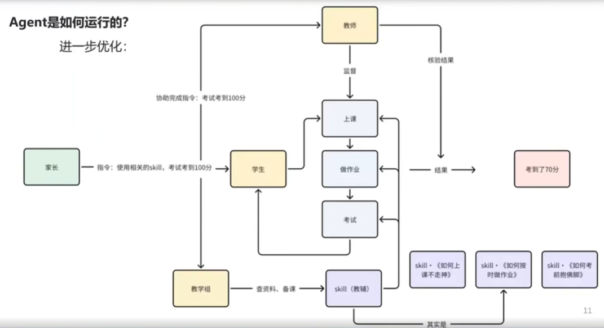
#### 总结  
agent 可以通过harness从环境中得到反馈（类似RL）  
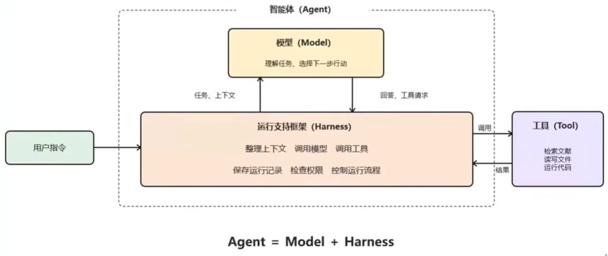
汇报人提到的agent框架，明显带有1个监管agent，1个主任务agent，1个skillagent（调用什么skill不是harness确定的吗？还需要专门的agent？？）  
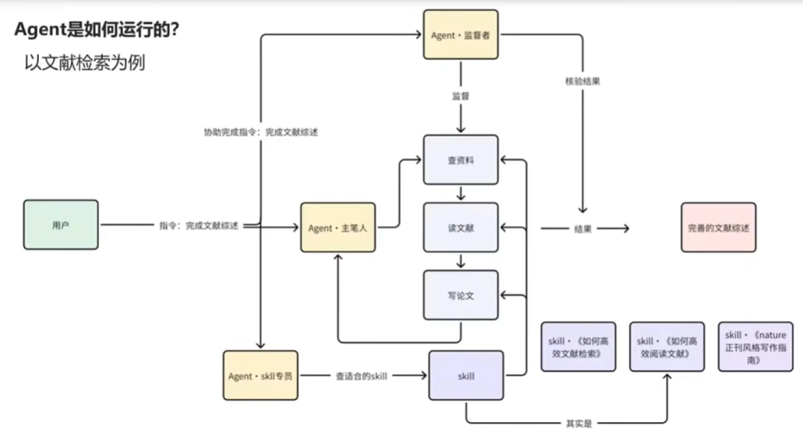
鼎鼎大名的ReAct架构  
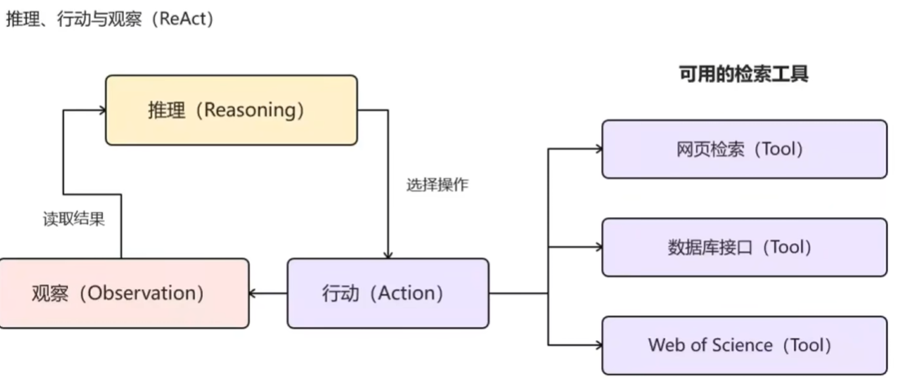
### DeepSeek Harness
重点是通过创造模式去创造自定义智能体  
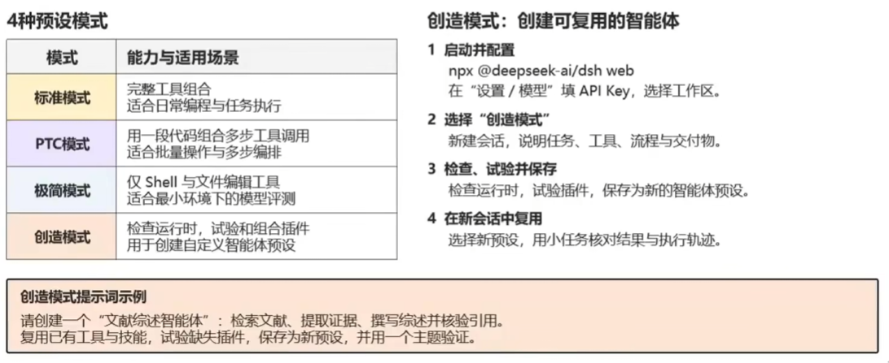
## skill 的设计与应用  
MCP：让智能体以规范形式接入外部工具或者数据库
SKILL：流程规范化
### skill 结构
```
skill-name/
├── SKILL.md (必需)：含 YAML frontmatter 的 Markdown 指令
├── scripts/ (可选)：可执行代码（Python、Bash 等）
├── references/ (可选)：按需加载的文档
└── assets/ (可选)：输出中使用的模板、字体、图标
```
### SKILL 调用时机
* 自主发现 
  根据上下文，去自动化发现SKILL（通过SKILL的name+description）,决定去加载哪个？
  ```
    ---
    name: your-skill-name
    description: What it does. Use when user asks to [specific phrases].
    ---
  ```
* 渐进式纰漏
  Skill 使用三级系统，只在需要时才把下一层放进上下文，决定去加载多少

    | 层级 | 内容 | 加载时机 |
    |------|------|----------|
    | 第一级：YAML frontmatter | 始终加载在 Claude 的系统提示中 | 始终；只提供足够信息让 Claude 判断何时使用该 Skill，不加载全部内容 |
    | 第二级：SKILL.md body | 完整的指令与指导 | Claude 认为该 Skill 与当前任务相关时 |
    | 第三级：链接文件 | Skill 目录内打包的额外文件 | Claude 按需导航和发现 |
### 文献调研SKILL
#### MCP
  通过MCP去核验文献来源真实性
 * OpenAlex 开放学术知识图谱，适合做文献发现、引用分析和研究趋势分析
 * Crossref 以DOI为核心的学术元数据服务，适合核验DOI和文献身份、补全规范题录
#### 实操
基于workbuddy的Hy4 flash进行构建
```
请你帮我创建一个问题拆解的skill，用来把研究问题拆解为更加规范、清晰的表述，先复述我的问题，然后转述我的问题与我对齐，确认后，按照表格的形式拆解为几个子问题并解释原因；请你帮我创建这个skill;把这个skill创建为项目级
```
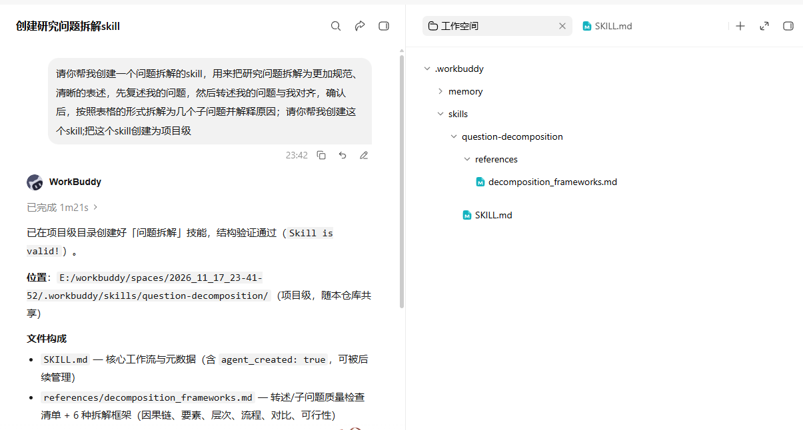
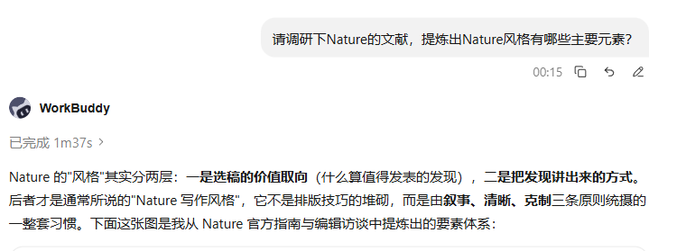


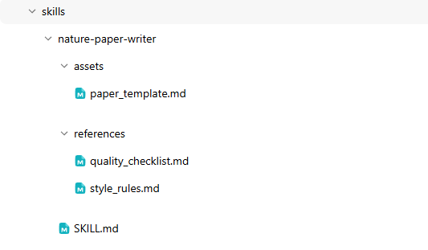  
最终生成了 [nature-paper-writer](./results/nature-paper-writer/),然后生成另一个motif的nature综述[DNA 基序发现：从概率模型到可检验的机制性表述](./results/motif_finding_review_nature_style.md)
## 参考资料
* https://resources.anthropic.com/hubfs/The-Complete-Guide-to-Building-Skill-for-Claude.pdf?hsLang=zh
* https://www.skillsdirectory.com/skills/luokai0-apply-anthropic-skill-best-practices
* https://www.anthropic.com/research/equipping-agents-for-the-real-world-with-agent-skills
* https://code.claude.com/docs/en/best-practices